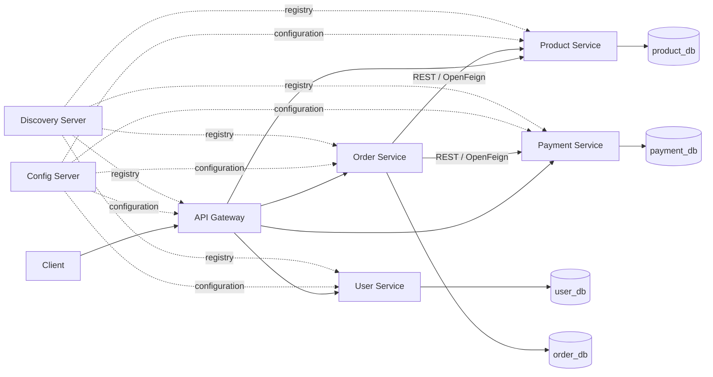

# E-Commerce Order Management System

A beginner-friendly Java microservices portfolio project. The system will support product and inventory management, user registration and JWT login, simulated idempotent payments, and an order workflow across independently owned PostgreSQL databases.

> **Implementation status:** Stage 2 Product Service is implemented. The remaining services and shared infrastructure are not yet implemented.

## Stage 1: decisions and environment

The repository was inspected before implementation and contained no existing application files. Maven is not installed (`mvn` is not recognized). The `java -version` probe stalls, so Java remains unverified. Before building further services, install Java 21 and Maven 3.9+ and verify with `java -version` and `mvn -version`. Docker availability is also unverified.

### Proposed versions

Use Java 21 and Spring Boot **3.5.x** with Spring Cloud **2025.0.x (Northfields)**. Spring's compatibility table maps Cloud 2025.0.x to Boot 3.5.x. The latest compatible patch at project start must be confirmed from official release pages when dependencies are added. Note that Spring Cloud announced 2025.0.3 as its final open source release and end of open source support on June 30, 2026; because the project explicitly requires Boot 3.x, this compatible line is appropriate for learning but has a support lifecycle limitation. Revisit the version choice if the project can later move to Boot 4.x.

Sources: [Spring Cloud compatibility table](https://spring.io/projects/spring-cloud/), [Spring Cloud 2025.0.3 release](https://spring.io/blog/2026/06/11/spring-cloud-2025-0-3-aka-northfields-has-been-released/).

### Architecture



Each business service owns its database and accesses other services only through APIs. The initial order flow is a small Saga-style process: reserve/decrement stock, attempt payment with an idempotency key, then confirm the order. Failures require explicit compensation or a clearly recorded unresolved state; independent database commits are not one atomic transaction. Timeouts can leave payment outcome unknown, so the workflow must query/retry with the same idempotency key before reporting a final outcome.

### Proposed repository layout

Independent Maven applications keep each service easy to run and deploy while avoiding a complex parent build early on.

```text
discovery-server/
config-server/
api-gateway/
user-service/
product-service/
order-service/
payment-service/
config-repo/            # local external configuration, no secrets committed
postman/
docker-compose.yml
.env.example
PROJECT_GUIDE.md
README.md
```

### Prerequisites and configuration risks

- Java 21 and Maven must be installed; current local versions could not be confirmed.
- Docker and Docker Compose are optional for local service development but required for the planned Compose workflow; availability is not confirmed.
- PostgreSQL credentials and JWT signing material must come from environment variables or ignored local configuration. `.env.example` will contain placeholders only.
- Config Server must start before configured services; Eureka must be reachable before discovery-based calls work. Database health/readiness must precede business services.
- Synchronous order processing spans independent commits. Payment retries must use idempotency keys, and unknown outcomes must not be represented as success.
- Backend services will validate JWTs and authorization themselves; gateway validation is an additional edge check, not a trust boundary.

## Implementation checklist

- [x] Stage 1: inspect repository and attempt toolchain discovery; establish architecture and documentation foundation.
- [ ] Stage 2: Product Service, PostgreSQL persistence, API and focused verification.
- [ ] Stage 3: User Service, validation, password hashing and user APIs.
- [ ] Stage 4: simulated Payment Service with idempotency and outcomes.
- [ ] Stage 5: Order Service workflow with OpenFeign and failure states.
- [ ] Stage 6: Eureka registration and discovery.
- [ ] Stage 7: Config Server and external configuration.
- [ ] Stage 8: Gateway routes and consistent error handling.
- [ ] Stage 9: JWT authentication and USER/ADMIN authorization.
- [ ] Stage 10: Resilience4j timeout, bounded safe retry and circuit breaker policies.
- [ ] Stage 11: Actuator, metrics, tracing and correlation identifiers.
- [ ] Stage 12: meaningful unit/integration tests, Docker Compose, Postman collection, and complete learner documentation.

## Stage 2: Product Service

The standalone Maven application lives in `product-service/`. Its `Product` entity is internal persistence state; request and response records keep the HTTP contract separate. `ProductService` owns the business operations, `ProductRepository` owns persistence access, and `ApiExceptionHandler` converts expected failures to consistent JSON errors.

Inventory reservation uses a database transaction and JPA `@Version` optimistic locking. A reservation above current stock returns 400; simultaneous writes that race on the same product can return 409 so a caller can reload and retry. This is a local inventory decrement only; the order workflow and any compensation are added in later stages. Authentication will also be added later, so do not expose this development service publicly.

### Product endpoints

| Method | Path | Request | Success | Common errors |
|---|---|---|---|---|
| POST | `/api/products` | `{"name":"Keyboard","description":"Mechanical","price":49.99,"stockQuantity":10}` | 201 with product JSON and `Location` | 400 invalid fields |
| GET | `/api/products` | — | 200 array | — |
| GET | `/api/products/{id}` | — | 200 product | 404 unknown ID |
| PUT | `/api/products/{id}` | `{"name":"Keyboard Pro","description":"Updated","price":59.99}` | 200 product | 400 invalid fields, 404 unknown ID |
| GET | `/api/products/{id}/availability?quantity=2` | — | 200 `{"productId":1,"requestedQuantity":2,"available":true}` | 400 invalid/non-positive quantity, 404 unknown ID |
| POST | `/api/products/{id}/reservations` | `{"quantity":2}` | 200 product with reduced stock | 400 invalid quantity or insufficient stock, 404 unknown ID, 409 concurrent update |

No Spring Security rules are in place yet; endpoints currently have no authentication requirement. Later security stages must protect them at the service as well as through the gateway.

### Run and manually exercise

Start a local PostgreSQL instance and create the service database/user, for example:

```sql
CREATE USER product_user WITH PASSWORD 'product_password';
CREATE DATABASE product_db OWNER product_user;
```

Set `PRODUCT_DB_URL`, `PRODUCT_DB_USERNAME`, and `PRODUCT_DB_PASSWORD` if your local values differ from the development defaults. Then run from `product-service/`:

```sh
mvn test
mvn spring-boot:run
```

Example requests (service listens on port 8082):

```sh
curl -i -X POST http://localhost:8082/api/products -H 'Content-Type: application/json' -d '{"name":"Keyboard","description":"Mechanical","price":49.99,"stockQuantity":10}'
curl 'http://localhost:8082/api/products/1/availability?quantity=2'
curl -i -X POST http://localhost:8082/api/products/1/reservations -H 'Content-Type: application/json' -d '{"quantity":2}'
```

`ProductServiceTest` is a unit test using a mocked repository. It checks successful stock decrement and rejection when quantity exceeds available stock. It has not run because Maven is unavailable; neither a successful build nor test result is claimed. A database-backed integration test is still needed in the later testing stage.
